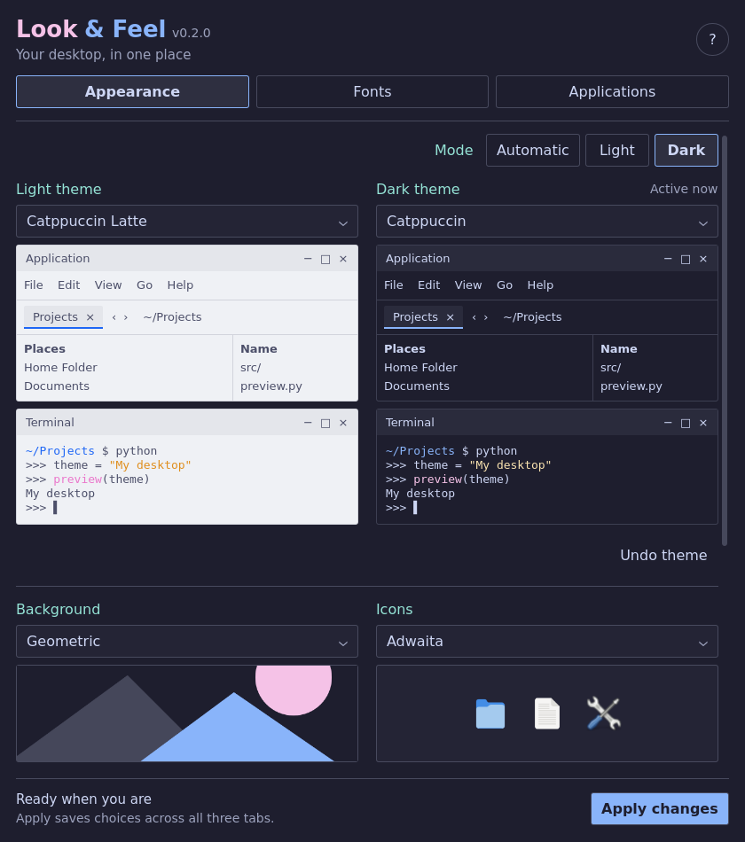
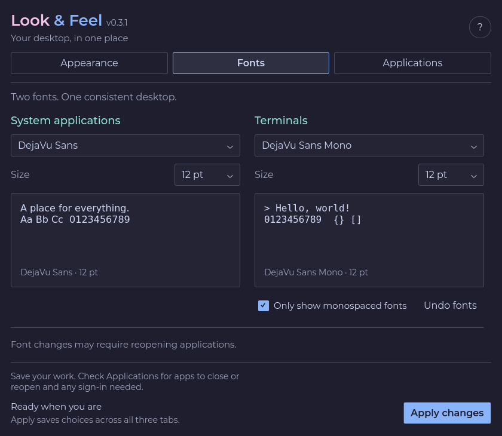
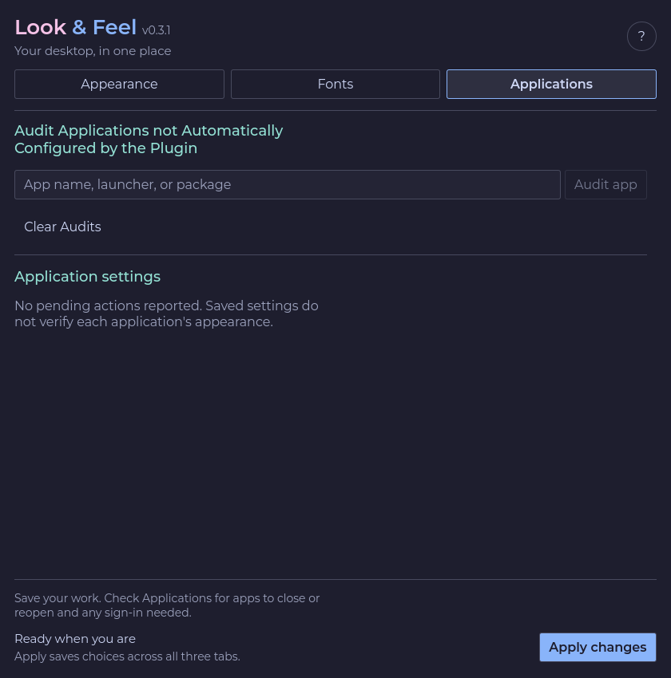
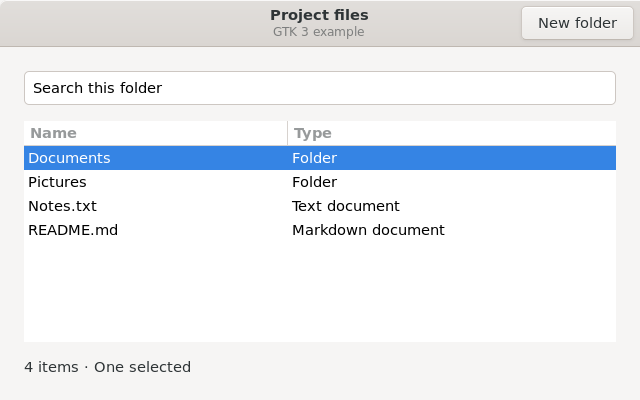
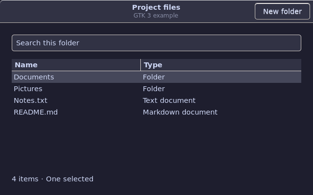

# Omarchy Look & Feel

One panel to make supported GTK, Qt and terminal apps follow your Omarchy theme.
Choose fonts, light/dark themes, terminal opacity and blur, backgrounds and icons, then press **Apply changes**.
Changes are journalled, with separate **Undo** controls for each section.

Version **0.2.0** · Development release · [Tested coverage](RELEASE_VALIDATION.md)

> **Automatic repair:** after you apply a choice, the loaded plugin checks saved
> themes, fonts, icons and terminal opacity on startup and every **15 seconds**, in all modes and
> even with the panel closed. **Hand edits to managed settings can be overwritten.**
> Undo the relevant choices or [disable the plugin](#undo-or-stop-managing-appearance)
> before managing those settings by hand. Background and boot artwork are not
> periodically reapplied.



[Install](#install) · [Use the panel](#first-use) · [Undo or disable](#undo-or-stop-managing-appearance) · [Screenshots](#screenshots) · [Technical details](#technical-details)

## What it does

- Applies a shared palette and fonts to supported GTK, Qt and terminal interfaces.
- Offers separate system and terminal fonts, light/dark themes, solar switching,
  terminal opacity, wallpaper and installed icon choices.
- Shows application actions that still need attention, such as closing an app
  or signing back in to activate Qt integration.
- Includes app-specific adapters and optional boot artwork, with separate Undo.
  Boot changes request administrator authentication when applied.

Coverage depends on the application's settings and toolkit. A detected app or a
successful Apply does not prove that every part of that app follows the theme.
See the [interface table](#apply-and-automatic-reconciliation) for supported targets.

## Install

Tested with **Omarchy 4.0.6**, **Hyprland 0.56.2** using the standard Lua
configuration, and **Python 3.11+**. Run these commands in your Omarchy session:

```sh
sudo pacman -S --needed python python-gobject gsettings-desktop-schemas fontconfig procps-ng pyside6 qt5ct qt6ct
omarchy plugin add https://github.com/conree/Omarchy_Look_and_Feel.git --enable --yes
python3 -B ~/.config/omarchy/plugins/si.omarchy-look-and-feel/controller.py doctor
```

The plugin manager installs and enables the panel; dependencies are installed
separately by the first command. `doctor` checks requirements without changing
settings and exits with status 2 if something is missing or unsupported. Older
or custom Omarchy builds may lack required theme-generation capabilities.

## First use

Save your work in all open applications before applying changes. Some
applications may need to be closed or restarted.

1. Open **Look & Feel** from its bar button.
2. Choose your mode, Light and Dark themes, and background in **Appearance**.
   **Terminal opacity** is a separate dropdown below the themes: keep current
   settings, or choose 0–100% in 5% steps. 70% opacity means 30% transparency.
   **Terminal blur** beside it offers Keep current, Off and On. It changes
   terminal blur independently of opacity, using the current compositor blur strength.
   Icons are optional. Put extra wallpaper images in `~/.config/omarchy/backgrounds/`.
3. Choose the system and terminal font families and sizes in **Fonts**.
4. Press **Apply changes**. It uses selections from all three tabs. Check
   **Applications** for any remaining actions and expand **Details** on a result
   when you need the full message.

If Qt integration needs activation, save your work, sign out and back in once,
then reopen applications. Close Brave, Typora and OnlyOffice when requested for
profile changes, and keep them closed until Apply or Undo finishes.

A failed step stops later steps. Completed steps remain applied and can be
undone from their section. Switching tabs preserves your draft choices;
restarting the shell clears unapplied drafts.

## Undo or stop managing appearance

Use **Undo theme**, **Undo opacity**, **Undo blur**, **Undo fonts**, or the **Undo** beside Background and Icons
to reverse the latest change in that section. Boot artwork has **Undo boot artwork**
and an explicit recovery action for interrupted operations.

Each Undo reverses one Apply and its associated automatic repairs. An earlier
saved choice may become active again. To return through all previous plugin
changes, repeat the relevant Undo controls while they remain available, then
disable or remove the plugin. If Undo reports a conflict, read its Details;
it will preserve edits it cannot safely restore.

Opacity applies to installed Ghostty, Alacritty, Kitty, Foot and WezTerm; it
preserves blur settings. Ghostty keeps explicitly coloured prompt and application cells opaque. Foot and Kitty may need to be fully quit and reopened; Applications
keeps the notice until the old process exits. Reload failures are retried.
Opacity has its own saved choice, automatic repair and Undo, independent of
fonts and light/dark palette selection. Application backgrounds in other terminals
still follow their native transparency rules. Unsupported custom configuration
syntax is refused. Undo merges preserve unrelated settings; an empty section
header can remain when another setting was changed after Apply.

To stop automatic repair and keep the current application settings:

```sh
omarchy plugin disable si.omarchy-look-and-feel
```

Disabling also releases the shell font binding. It does **not** restore other
application settings or erase saved choices. Re-enabling resumes saved choices.
There is no separate repair-only switch; closing the panel does not stop repair.

Update with `omarchy plugin update si.omarchy-look-and-feel`.
To uninstall, use `omarchy plugin remove si.omarchy-look-and-feel`.
Undo first if you want prior settings restored before removal.

## Screenshots

The Appearance image above and the tabs below are native renders of the current
panel with sample catalog/application data, captured in an isolated Qt window.
They show the controls and layout; the application list is illustrative.

| Fonts | Applications |
| --- | --- |
| [](docs/screenshots/fonts.png) | [](docs/screenshots/applications.png) |

The same native GTK 3 example before and after loading the plugin's generated
Catppuccin stylesheet:

| Before: Adwaita | After: Catppuccin |
| --- | --- |
|  |  |

These captures demonstrate the generated palette, not every application's
rendering or an end-to-end desktop Apply. Reproduce them with
[`docs/capture_screenshots.py`](docs/capture_screenshots.py) and
[`docs/capture_gtk.py`](docs/capture_gtk.py). The helpers describe their requirements;
they use temporary displays and do not apply settings to your desktop.
Root `preview.png` copies the Appearance capture for the Marketplace listing.

## Technical details

The sections below cover behavior, supported interfaces, catalogs and source
files. For development and testing, start with [PROJECT_STATUS.md](PROJECT_STATUS.md),
[SOURCE_OF_TRUTH.md](SOURCE_OF_TRUTH.md) and [RELEASE_VALIDATION.md](RELEASE_VALIDATION.md).

Optional `binutils` improves toolkit discovery through `readelf`. Application
packages are needed only for apps you use. The current source tree bundles no
paid fonts, commercial themes or owner profiles. Earlier commits retain four
unused owner-theme unlock image copies that were removed from the current tree.
Runtime previews use assets already installed by the user.

## Using the panel

The panel has three tabs, with one **Apply changes** button always available
below the scrolling content. Each drop-down sits directly below its heading,
with its example underneath. The Mode label sits beside the three mode buttons:

- **Appearance:** choose Automatic, Light or Dark mode, compare previews of the
  installed light/dark palettes with separate application and terminal examples,
  and select a background and optional icon theme. Application examples show menus,
  tabs and a file list; terminal examples use the selected terminal font and palette.
  Background thumbnails and icon samples use your installed files. Boot artwork
  is shown inline by default; choosing a logo updates the image immediately.
  A changed selection is applied last and requests administrator authentication.
- **Fonts:** compare samples of the selected system and terminal fonts at their
  chosen sizes. The monospace filter belongs to the terminal selector. Samples
  demonstrate the font in this panel; they do not verify another application.
- **Applications:** review outstanding actions and audit applications not
  automatically configured by the plugin.

An application audit searches installed launchers and packages and saves its
result. **Font support detected** means the app matches an existing shared GTK,
Qt, or supported terminal font control. It does not apply the font, add an
adapter, verify the rendered font, or register app-specific theme controls.
**Font support not detected** means the app was not found, the search was
ambiguous, or its font control is unsupported. Ambiguous and unsupported matches
are saved and block Fonts Apply and automatic font repair. Earlier steps of
**Apply changes** may already have completed before Fonts stops. A more specific
audit does not remove an earlier ambiguous result. **Clear Audits** removes
all saved manual audit records, including supported ones, without undoing settings
or removing automatic support. A search with no match saves no new record.

PCManFM is listed for reopening when its GTK appearance settings change while
its process is being monitored. Fully quit and reopen it to clear that notice;
closing a window can leave it running. The notice checks process lifetime and
settings changes, not rendered appearance, and cannot detect changes made before
the process was first observed.

Brave can display **Custom** for a selected font variant whose name is an alias,
such as **Visby CF Medium**. Its font menu lists primary family names only. Look
& Feel preserves the selected variant and explains this label in the font result.
Choosing the parent **Visby CF** family instead can select its Regular face.

Switching tabs, reopening the panel and refreshing the catalog preserve drafts
while the plugin instance remains loaded. Drafts are not saved across a shell
restart. **Apply changes** uses selections from all three tabs. Section results
describe the last action; expand **Details** for the full result. Undo remains
separate for themes, opacity, fonts, backgrounds, icons and boot artwork. Interrupted
boot operations expose an explicit **Recover boot artwork** action. Font Undo refreshes the font
choices without discarding unrelated drafts.

The panel derives accents from the active palette, checks text contrast, and
uses the desktop system font for its controls. Light and dark themes share the
same layout; smaller panels stack the previews into a single column.

Examples are prepared when the plugin loads and reused when the panel opens.
A disposable preview catalog under `~/.cache/omarchy-look-and-feel/` (or
`XDG_CACHE_HOME`) provides examples while live settings refresh in the background.
Apply and appearance selectors wait for that first live refresh; cached data
never enables Apply or Undo. The first run without a cache still needs discovery.

## Apply and automatic reconciliation

The plugin saves the chosen fonts and light/dark themes in one desired-state
file: `~/.config/omarchy-look-and-feel/policy.json` (or its XDG equivalent).
Apply generates configuration from the selected palette and detected application
interfaces. No Alucard, Van Helsing, user name, or particular font is required.
The bar checks saved choices immediately on load and every 15 seconds while
loaded, in Light, Dark and Automatic modes, even with the panel closed. It
repairs supported configuration drift, including hand edits to managed values.
Automatic mode also follows the solar phase. Themes, fonts and icons are managed;
background and boot artwork are excluded from periodic repair. It does
nothing to appearance until a choice has been applied. Background is applied
separately. An installed icon theme can be applied independently across desktop,
GTK and available Qt integrations, with its own Undo.

The panel runs Theme, Fonts, Background, optional Icons, then explicitly changed
boot artwork with administrator authentication. A failed step stops later steps;
completed steps remain available to Undo. Pending application work is named.
Saved configuration, requested reloads, and rendered appearance are separate
results: a successful file write is never proof of what an application displays.

| Interface | What the plugin applies |
| --- | --- |
| GTK 3/4 and desktop settings | Font, normalized text-scaling factor, icons, light/dark preference, generated palette; competing appearance declarations in user GTK CSS are removed while layout is retained. |
| Qt through qt5ct/qt6ct | System/fixed fonts, installed icon theme and generated palette. Apply detects a selector shared by both installed integrations and saves one owned override in the standard Omarchy Hyprland Lua config. A fresh login activates it for all launchers. Qt 6 can inherit GTK colors; Qt 5 GTK integration alone does not supply the palette. |
| Ghostty, Alacritty, Kitty, Foot, WezTerm | Detected terminal fonts; Omarchy terminal palettes plus a generated WezTerm override. Supported reloads preserve sessions. Foot color refresh uses only owned PTYs; font changes need new Foot windows. |
| Omarchy shell | A shared runtime system-font binding, with point-to-pixel size conversion and restoration when font ownership ends. No separate shell-font plugin is required. |
| Typora | System font for prose, terminal font for code, generated theme and user CSS conflict repair. Its native profile is activated once while closed; subsequent theme changes update the managed stylesheet. |
| Betterbird | Selected profile's font preferences, with its native profile lock held. Ambiguous profiles remain pending. |
| Brave | Default profile's standard/serif/sans/fixed font preferences while closed; conflicting unpacked theme-only launch flags can be removed. Enterprise policy is never rewritten. |
| OnlyOffice | Reversible native-frame setting and launcher flag, avoiding its custom transparent frame. Apply requires closure when changing its native setting. |

Application adapters ship with the plugin and derive values from the same saved
choices. They are not host-specific scripts. Unknown application-owned controls,
custom command-line configuration overrides, Flatpak/Snap-specific config paths,
and unsupported schemas still need adapters; generic toolkit inheritance cannot
force every application to comply. The inventory does not claim exhaustive app
discovery. Manual audit registers identified GTK, Qt 5/6 and supported terminal font surfaces. App-owned editor controls remain separate. Runtime detection distinguishes Electron/Flutter content from their GTK window shell and recognizes Python Qt launchers and Qt Quick binaries.

PySide6 validates Qt font serialization and reads integration metadata without loading the integration libraries. Both qt5ct and qt6ct must offer a common selector before the plugin changes the desktop integration. Unsupported/custom Lua configurations remain pending. The background timer cannot introduce this override: it needs an explicit Apply. Apply and Undo require a fresh login when the selector changes; existing processes keep their old environment. The plugin does not restart the session or change activation variables live.

The transaction journal snapshots original data, records ownership of individual
fields in shared GTK/Qt, policy, Typora and WezTerm files, and groups automatic
repairs under the initiating Apply. Theme Undo preserves a later font choice;
font Undo preserves a later theme choice. Unrelated application preferences and
WezTerm Lua settings are retained. Unrecognized conflicting structures cause a refusal. Recognized managed values
can be replaced during automatic repair, including manual edits to those values.
The refusal checks do not make hand edits to managed settings persistent. Interrupted operations recover from durable journals.
Qt font records are checked for valid native fields before use. Font Apply repairs
malformed records while preserving valid custom font attributes. Undo and recovery
refuse to restore a malformed saved font, including in older journals; the repaired
settings and original journal remain available for review. Palette/icon-only Undo
does not replace unrelated font fields. Newly enabling Qt integration is deferred
if its existing font records are malformed: apply fonts, then Apply again.
New files may leave empty directories after Undo.

Keep Brave, Typora and OnlyOffice closed until an explicit profile Apply or Undo finishes.
Their closed-state checks do not provide application-respected exclusion against
concurrent starts; periodic reconciliation never writes those offline profiles.
Betterbird uses its native fcntl lock. A stale owned local PID lock is removed
only after acquiring that lock, checking the dead local owner, and recording a
private audit. Unknown or live locks are preserved.

Theme generation requires an Omarchy version with the inspected headless branch.
The plugin skips the normal post-theme hook chain and privileged browser-policy
writer, then refreshes explicit desktop/session interfaces. Normal Hyprland
reload still evaluates its usual configuration. Some Omarchy application retints
outside these adapters are not invoked, including managed browser custom tint.
Theme Undo re-applies the previous theme's desktop defaults; it does not restore
independently customized pre-Apply theme GSettings. Font and icon GSettings Undo restore explicit versus unset values. Font Apply
owns GNOME text-scaling-factor as a double and sets it to 1.0. Foot uses
compositor-relative sizing (`dpi-aware=no`); compositor scale itself is retained.

Font Apply also repairs the recognized Omarchy user Fontconfig rule that can
replace explicitly requested fonts after `omarchy font set`. It limits that
rule to the first requested family and journals the rule separately from
unrelated XML. Unknown competing rules or includes require review and are
preserved. This does not promise that a bare `monospace` request follows the
terminal choice: earlier distribution rules can already have resolved that
generic family. Supported applications receive explicit selected families.

Boot unlock artwork has explicit Apply, Undo and interrupted-operation recovery.
Selecting a different logo includes it as the last Apply step and opens the normal
administrator authentication prompt. The preview shows that logo against the
existing boot background; Plymouth colours and the login-screen theme are preserved.
The backend builds each current UKI in a private staging directory, verifies its
embedded Plymouth assets and bootloader checksum, then publishes it under the
standard boot-partition lock. Undo restores saved bytes and refuses intervening
kernel or configuration changes. Background reconciliation never performs boot work.

This feature supports the standard unsigned Omarchy UKI layout on `/boot`, with
one or multiple installed kernels. Secure Boot/signed images, enrolled Limine
configurations, fallback/custom UKI options and unhandled image sections are
refused before changes. It requires `pkexec`, `mkinitcpio`, `lsinitcpio` and
`limine-entry-tool`; detailed privileged preflight runs after authentication.
Recovery backups remain root-private under `/var/lib/omarchy-look-and-feel`.
Older unverified unlock journals are preserved and cannot authorize Undo.

An optional **Only show monospaced fonts** filter uses Fontconfig metadata and
retains the current selection. Inventory and preferences are stored under XDG
user directories. No separate service or timer is installed: automatic repair
and transitions run only while the plugin is loaded in the shell.

This is still development software. Isolated fixtures and the stock/owner VM
checks verify ownership, recovery, generated configuration and selected native
GTK/Qt behavior; they do not establish visual correctness in every application.
The source of owner requirements is [`DESIGN_BRIEF.md`](DESIGN_BRIEF.md).

## Source files

- `manifest.json`: Omarchy plugin declaration.
- `BarWidget.qml`: bar entry, popup lifecycle and guarded reconciliation timer.
- `ShellFontBridge.qml`: one runtime font binding shared across monitors, released when the final widget leaves.
- `appearance_policy.py`: desired state, serialized operations and grouped theme Undo.
- `application_restarts.py`: process-lifetime observations for PCManFM restart notices.
- `application_themes.py`: palette-driven toolkit and application adapters.
- `managed_preferences.py`: per-field codecs and ownership-aware restoration.
- `css_takeover.py`: syntax-aware CSS conflict repair preserving layout.
- `wezterm_blocks.py`: separately owned Lua font/theme overrides; source is never executed by the adapter.
- `theme_runtime.py`: capability-checked headless generation refresh.
- `Panel.qml`: tabbed appearance controls, previews, built-in Help, the single
  **Apply changes** action, Undo controls, and the missed-app audit workflow.
- `boot_unlock.py` / `boot_unlock_helper.py`: explicit authenticated, staged and verified boot-artwork transactions.
- `panel_preview_cache.py`: disposable private display cache; it never authorizes writes.
- `appearance_previews.py`: read-only palette previews and bounded installed-icon
  sample resolution, including icon-theme inheritance.
- `controller.py`: application/catalog discovery, global font routes, and
  appearance Apply/Undo routes.
- `FontActionResult.js`: combined command output/exit evaluation for font Apply and Undo.
- `desktop_fonts.py`: typed, journaled GSettings font/scaling/icon values and exact unset-state restoration.
- `fontconfig_policy.py`: narrow XML rule repair, native font-resolution protection and owned-rule Undo.
- `icon_actions.py`: installed icon-theme Apply, drift repair and independent Undo.
- `requirements.py`: read-only dependency diagnostics and operation/recovery preflight.
- `terminal_reload.py`: supported reload requests that preserve terminal sessions.
- `app_font_actions.py`: Typora CSS and closed-profile mail font edits.
- `browser_font_actions.py`: closed default-profile browser font edits and per-key Undo.
- `global_font_actions.py`: reversible GTK, Omarchy shell, and detected
  supported-terminal font target generation.
- `appearance_audit.py`: read-only configuration and active-theme/Plymouth
  readback used by `controller.py audit-appearance JSON`.
- `font_application_inventory.py`: desktop-app, package-source, AppImage,
  curated CLI/TUI, and Quickshell widget font-surface scan; writes the current
  record atomically to `~/.local/state/omarchy-look-and-feel/font-application-inventory.json`.
- `manual_app_inspector.py`: targeted user-requested app lookup, kept separate
  from the startup census.
- `manual_app_registry.py`: private registration and Apply-time validation for
  supported shared font surfaces discovered by manual audit.
- `font-application-inventory.schema.json`: record contract for the installed
  application and shell-font census.
- Theme and unlock choices are discovered directly from the active Omarchy
  theme roots. Apply uses Omarchy's supported commands. Backgrounds come from
  live Omarchy paths and the current wallpaper. Icons use installed themes with portable identifiers; selection does
  not import or redistribute icon artwork or assert its redistribution license.
- `appearance_actions.py`: journaled apply/readback/undo for Omarchy theme,
  background selections. Theme undo is a semantic
  compensation because Omarchy commands update generated/runtime and system
  assets beyond a user-owned file snapshot.
- `solar_schedule.py`: offline approximate local sunrise/sunset calculations
  and next Light/Dark transition selection, evaluated by reconciliation.
- `catalog-entry.schema.json`: metadata contract for stable, read-only
  catalog entries. Review metadata is recorded separately from installed-font
  availability; installed fonts remain selectable.
- `transaction.py`: reversible file transaction core and target allowlist.
- `terminal-font.schema.json`: contract for the saved Terminal dropdown value.
- `settings.schema.json` and `settings.example.json`: version 2 of the
  plugin-owned preference contract and an intentionally unselected example.
- `APPLY_TRANSACTION.html`: printable contract for safe apply, journaling,
  backups, verification, rollback, and interruption recovery.
- `APPLICATION_SUPPORT_MATRIX.html`: printable read-only audit of app control points, local versions, conflicts, and unverified support claims.

## Live appearance catalogs

Themes and unlock designs come directly from the configured Omarchy root
(`$OMARCHY_PATH`, `/etc/omarchy.conf`, or `/usr/share/omarchy`) and
`~/.config/omarchy/themes/`. Unlock designs need both `unlock.png` and
`preview-unlock.png`; designs whose logos cannot be uniquely verified are
excluded from the independent boot-unlock selector.
Stock themes live in the Omarchy tree and user themes in
`~/.config/omarchy/themes/`. Each theme may include `backgrounds/` and unlock
assets. Background discovery scans those theme folders,
`~/.config/omarchy/backgrounds/` (including per-theme subfolders), and
`backgrounds/` under the configured Omarchy root. It also includes the active
wallpaper at `~/.local/state/omarchy/current/background`, even when the image is
stored elsewhere. Put additional wallpaper images in
`~/.config/omarchy/backgrounds/`; there is no machine-specific Documents scan.
Fonts are discovered through Fontconfig; icons through active XDG data directories.
The old copied catalog
under `~/.local/share/omarchy-look-and-feel/catalogs/` is not read for dropdown
discovery, so newly installed and updated Omarchy themes appear without a
separate snapshot refresh.

External discovery references are recorded in `DESIGN_BRIEF.md`. Community
themes need per-project compatibility and license review before import. The
third-party wallpaper collection is not bulk-imported because its README says
the maintainer does not own the images.

Installed fonts are discovered through Fontconfig and remain selectable even
without a reviewed metadata record. `font-reviews.json` records source and
license evidence for Aileron and Office Code Pro; it does not install fonts or
verify every installed file bearing those family names. Office Code Pro now
uses a public [Font Library archive](https://fontlibrary.org/en/font/office-code-pro)
with its recorded SHA-256 and included SIL Open Font License 1.1. No local
Downloads folder is needed. Review source and license separately before
redistributing any fonts or artwork.

## Validation and remaining coverage

The October 28 release sweep passes all 28 test programs, current-build VM
light/dark Apply/Undo, clean-profile installation/update, PCManFM restart
behavior, native Brave font rendering and graphical boot authentication/cold
boots. See [the release report](RELEASE_VALIDATION.md) for exact scope and
remaining physical-desktop acceptance.

Run the scripts in `tests/` from this source directory. The portable, terminal,
application and browser suites create isolated homes. `check_native_qt.py` uses
an offscreen native Qt widget. The native Qt5/serialization tests also require
Qt5 development headers, `pkg-config`, and a C++ compiler.
`check_stale_mail_lock.py` needs local socket-bind
capability and is also run in the VMs. VM tooling and results belong under
`Testing/Boot_VM_Lab/`; guest guards must remain enabled.

Remaining coverage includes unsupported application-owned controls and profiles,
full live visual testing across apps and physical hardware, fonts/scales beyond
the measured VM matrix, and graphical Plymouth rendering on physical hardware.
Do not infer boot safety from appearance tests or claim every application's
rendering has been verified.
